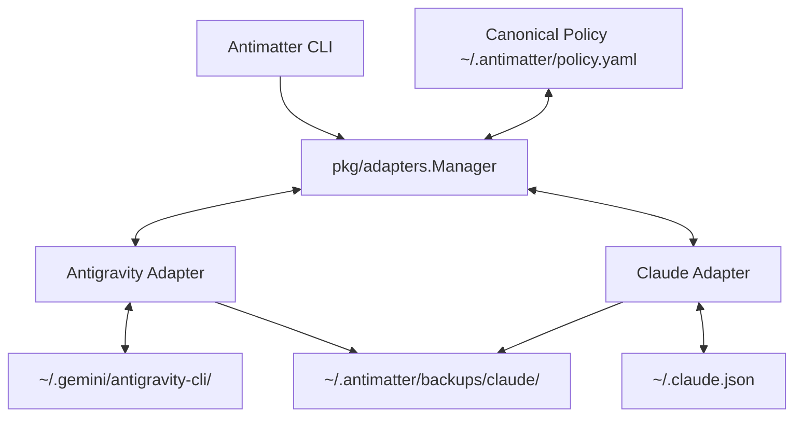

# Track Design: Live Agent Adapters for Antigravity & Claude Code

## System Architecture



## Adapter Interface

```go
type Adapter interface {
    Name() string
    Detected() bool
    ConfigPath() string
    Export(p *policy.Policy) error
    Import() (*policy.Policy, error)
    Backup() (string, error)
}
```

## Data Translation Specifications

1. **Antigravity Mapping**:
   - Source: `~/.gemini/antigravity-cli/settings.json` or whitelist policy files.
   - Whitelisted CLI commands compiled to Antigravity execution rule structures.
   - MCP tool permissions mapped to allowed tool identifiers.

2. **Claude Mapping**:
   - Source: `~/.claude.json` / `.claude/settings.json`.
   - Maps `allowedTools` (e.g., `["Bash", "Glob", "Grep", "Read", "Write", "mcp__*"]`).
   - Maps allowed command patterns into Claude auto-approval arrays.
