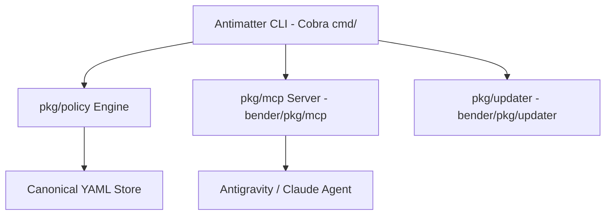

# Track Design: CLI Foundation & Policy Engine Scaffold

## System Architecture



## Component Breakdown

1. **Entry Point & Commands (`cmd/`, `main.go`)**:
   - `main.go`: Calls `cmd.Execute()`.
   - `cmd/root.go`: Root command definition, persistent flags (`--config`, `--verbose`).
   - `cmd/version.go`: Formatted version and build info.
   - `cmd/whitelist.go`: Subcommands `list`, `add`, `check` for testing command execution against current policies.
   - `cmd/mcp.go`: stdio MCP server runner and client config installer.
   - `cmd/update.go`: Self-updater command.

2. **Policy Engine (`pkg/policy`)**:
   - `types.go`:
     - `Policy`: Top-level policy container containing metadata and rules.
     - `Rule`: Generic permission entry.
     - `RuleType`: Enum (`CommandRule`, `ToolRule`, `PathRule`).
     - `MatchMode`: Enum (`Exact`, `Glob`, `Regex`, `Prefix`).
     - `Decision`: Enum (`Allow`, `Deny`, `Ask`).
   - `evaluator.go`: Fast matcher checking if a candidate command or tool call is permitted under active policy.
   - `codec.go`: YAML/JSON encoding, decoding, validation, and error reporting.
   - `merger.go`: Deterministic rule set merger.

3. **Version & Build Metadata (`pkg/version`)**:
   - Variables populated via `-ldflags` (`Version`, `Commit`, `Date`).

## Data Models

```go
type RuleType string
const (
    RuleTypeCommand RuleType = "command"
    RuleTypeTool    RuleType = "tool"
)

type MatchMode string
const (
    MatchExact  MatchMode = "exact"
    MatchPrefix MatchMode = "prefix"
    MatchGlob   MatchMode = "glob"
    MatchRegex  MatchMode = "regex"
)

type PolicyRule struct {
    ID          string    `json:"id" yaml:"id"`
    Type        RuleType  `json:"type" yaml:"type"`
    Pattern     string    `json:"pattern" yaml:"pattern"`
    MatchMode   MatchMode `json:"match_mode" yaml:"match_mode"`
    Description string    `json:"description,omitempty" yaml:"description,omitempty"`
    Agents      []string  `json:"agents,omitempty" yaml:"agents,omitempty"` // "antigravity", "claude", "all"
}

type Policy struct {
    Version     string       `json:"version" yaml:"version"`
    Name        string       `json:"name" yaml:"name"`
    Rules       []PolicyRule `json:"rules" yaml:"rules"`
}
```
