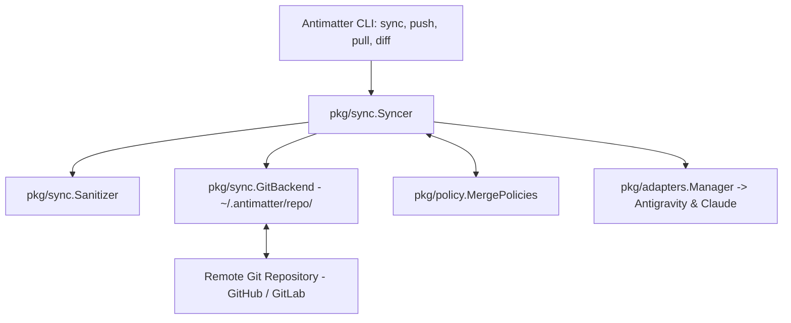

# Track Design: Git-Backed Remote Sync Engine

## System Architecture

## Component Breakdown

1. **Git Backend (`pkg/sync/git.go`)**:
   - Manages a bare or standard Git repository at `~/.antimatter/repo/`.
   - Operations: `Init()`, `SetRemote()`, `GetRemote()`, `Pull()`, `Push()`, `Status()`, `Diff()`.

2. **Secret Sanitizer (`pkg/sync/sanitizer.go`)**:
   - Detects dangerous hardcoded secrets or API tokens inside command arguments or rule patterns (`sk-ant-`, `ghp_`, `Bearer `, `ey...`).
   - Masks or rejects rules containing secrets prior to git staging.

3. **Sync Orchestrator (`pkg/sync/syncer.go`)**:
   - Pulls remote policy -> reconciles via `policy.MergePolicies` -> exports to active agent adapters -> sanitizes & commits local changes -> pushes upstream.

4. **CLI Commands (`cmd/sync.go`)**:
   - `antimatter sync`
   - `antimatter push`
   - `antimatter pull`
   - `antimatter diff`
   - `antimatter remote`
