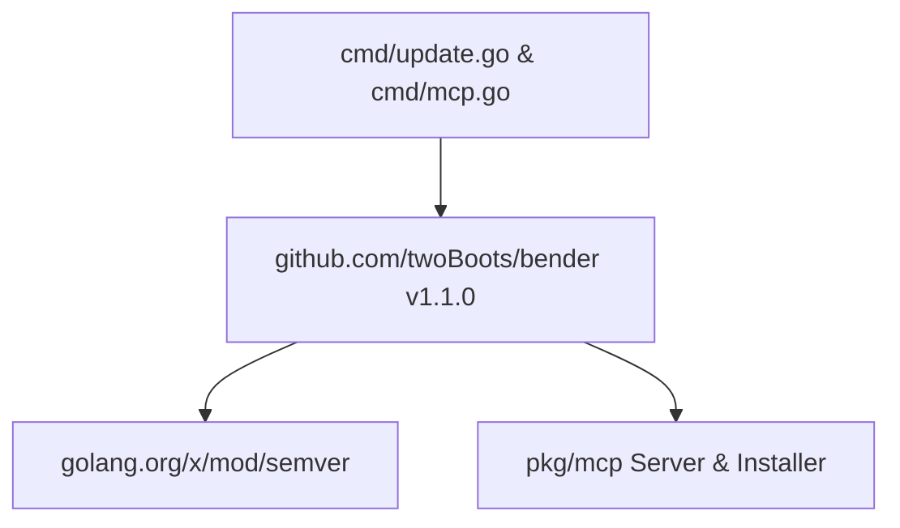

# Design Document: Upgrade Bender to v1.1.0

## Architecture Overview

## Technical Decisions
1. **Promote Direct Dependency**: `cmd/update.go` and `cmd/mcp.go` directly import `github.com/twoBoots/bender/pkg/updater` and `github.com/twoBoots/bender/pkg/mcp`. Explicitly declare `github.com/twoBoots/bender v1.1.0` in the main `require` block of `go.mod`.
2. **Updater Verification**: Validate that `antimatter update --check` and `antimatter update --target-version` correctly invoke the new SemVer comparison logic in Bender v1.1.0 without regressions.
3. **MCP Server Verification**: Validate that `BuildMCPServer` and `NewMCPCmd` correctly initialize and register tools under Bender v1.1.0.
