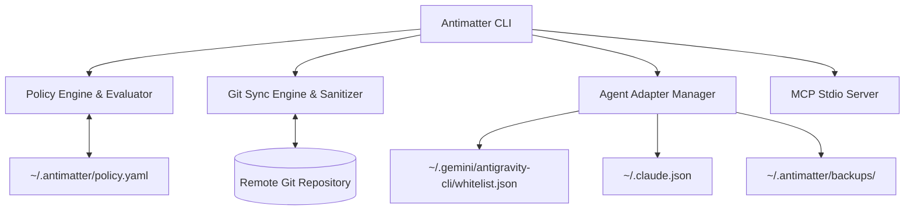

# Antimatter

[](https://github.com/twoBoots/antimatter/actions/workflows/ci.yml)
[](https://github.com/twoBoots/antimatter/actions/workflows/release.yml)
[](https://golang.org)
[](LICENSE)

> Cross-device synchronization and policy management for **Google Antigravity** and **Claude Code** whitelists and tool approvals.

---

## ⚡ Overview

**Antimatter** is a developer tool and background synchronization engine designed to version control, persist, and share allowed tool calls and approved CLI execution commands across all your devices and AI coding assistants.

- 🔄 **Cross-Compatible**: Unifies permission models across **Google Antigravity** (`~/.gemini/antigravity-cli/`) and **Claude Code / Desktop** (`~/.claude.json`).
- 🔐 **Git-Backed Dotfiles**: Persists and version controls your whitelist policy using a dedicated Git repository.
- 🛡️ **Zero Secret Leaks**: Built-in sanitization engine automatically detects and redacts API tokens (`sk-ant-`, `ghp_`, `AIza`, JWTs) before pushing upstream.
- 💾 **Non-Destructive Backups**: Automatically creates timestamped backups in `~/.antimatter/backups/` before any write.
- 🔌 **Model Context Protocol (MCP)**: Native stdio JSON-RPC 2.0 server allowing LLMs to query and check permission states dynamically.
- 🚀 **In-Place Self-Updater**: One-command self-updater powered by [`twoBoots/bender`](https://github.com/twoBoots/bender).

---

## 📦 Installation

### Pre-built Binaries

Download the latest pre-compiled binary for your architecture from [GitHub Releases](https://github.com/twoBoots/antimatter/releases/latest):

```bash
# macOS (Apple Silicon M1/M2/M3/M4)
curl -sSL https://github.com/twoBoots/antimatter/releases/latest/download/antimatter-darwin-aarch64 -o /usr/local/bin/antimatter && chmod +x /usr/local/bin/antimatter

# macOS (Intel)
curl -sSL https://github.com/twoBoots/antimatter/releases/latest/download/antimatter-darwin-x86_64 -o /usr/local/bin/antimatter && chmod +x /usr/local/bin/antimatter

# Linux (x86_64)
curl -sSL https://github.com/twoBoots/antimatter/releases/latest/download/antimatter-linux-x86_64 -o /usr/local/bin/antimatter && chmod +x /usr/local/bin/antimatter

# Linux (ARM64)
curl -sSL https://github.com/twoBoots/antimatter/releases/latest/download/antimatter-linux-aarch64 -o /usr/local/bin/antimatter && chmod +x /usr/local/bin/antimatter
```

### Install from Source

```bash
git clone https://github.com/twoBoots/antimatter.git
cd antimatter
go install .
```

---

## 🚀 Quick Start

### 1. Check Assistant Detection & Status

Inspect which AI assistants are detected on your machine:

```bash
antimatter status
```

Output:
```
==================================================
          Antimatter Policy Status                
==================================================
Active Policy File: /Users/brew/.antimatter/policy.yaml
Profile Name:       default
Total Rules:        5

Configured Agent Adapters:
------------------------------------------------------------
• Google Antigravity   [Active/Detected]
  Config Path: /Users/brew/.gemini/antigravity-cli/whitelist.json
• Claude Code          [Active/Detected]
  Config Path: /Users/brew/.claude.json
```

---

### 2. Whitelist Management

Add whitelisted CLI commands or tool approvals:

```bash
# Allow exact command
antimatter whitelist add --pattern "git status" --mode exact --desc "Allow git status"

# Allow command prefix across all agents
antimatter whitelist add --pattern "go test" --mode prefix --agent all

# Allow specific MCP tool call
antimatter whitelist add --pattern "view_file" --type tool --mode exact

# Test if a command is allowed
antimatter whitelist check "git status"
antimatter whitelist check "rm -rf /"
```

List all configured rules:

```bash
antimatter whitelist list
```

---

### 3. Agent Synchronization & Dotfiles

Connect Antimatter to your personal dotfiles Git repository:

```bash
# Configure remote repository
antimatter remote set git@github.com:yourusername/my-agent-dotfiles.git

# Synchronize everything (Pull -> Reconcile -> Export to Antigravity & Claude -> Sanitize -> Push)
antimatter sync

# View uncommitted local policy diffs
antimatter diff

# Push local policy changes
antimatter push -m "Add kubernetes cli commands to whitelist"

# Pull and merge remote policy changes
antimatter pull
```

---

### 4. Model Context Protocol (MCP) Integration

Antimatter can run as an MCP server to let AI assistants inspect permissions in real time.

#### One-Click Install to Clients

```bash
# Automatically install into Claude Desktop, Claude Code, Cursor, etc.
antimatter mcp install
```

#### Manual Claude Desktop Configuration

Add to `claude_desktop_config.json`:

```json
{
  "mcpServers": {
    "antimatter": {
      "command": "antimatter",
      "args": ["mcp"]
    }
  }
}
```

---

### 5. In-Place Self-Updating

Update Antimatter to the newest release at any time:

```bash
# Check for available updates
antimatter update --check

# Perform in-place upgrade
antimatter update
```

---

## 🏗️ Architecture



---

## 🧪 Testing & Quality

Antimatter enforces strict Spec-Driven Development (Cooper SDD) and Test-Driven Development (TDD) with >80% code coverage.

```bash
# Run full test suite with race detection and coverage
go test -race -v -coverprofile=coverage.out ./...
go tool cover -func=coverage.out
```

---

## 📄 License

MIT License © 2026 twoBoots
